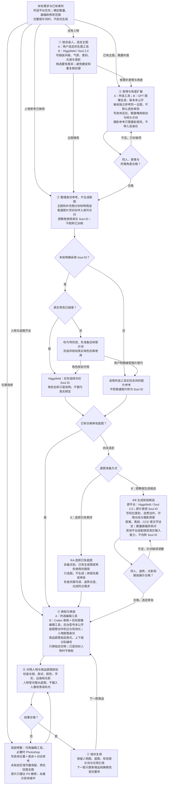

# 服装街拍 v2.0.0：平台选择与提示词流程

图中 A 表示通用已有底图路线，B 表示原教学视频展示的平台组合。**用户已指定平台时优先沿用该平台**；借用原教程方法，不等于自动换服务或已启用 Soul ID。Soul 2.0 与 Soul V2 为同一模型名称写法。

[主 Skill](../SKILL.md) · [完整分步提示词](step-prompts.md) · [原教程平台与证据](tutorial-platforms.md)

完整提示词与附件对应示例见[分步手册](step-prompts.md)。原平台与未披露信息的定位见[平台对照表](tutorial-platforms.md)。
